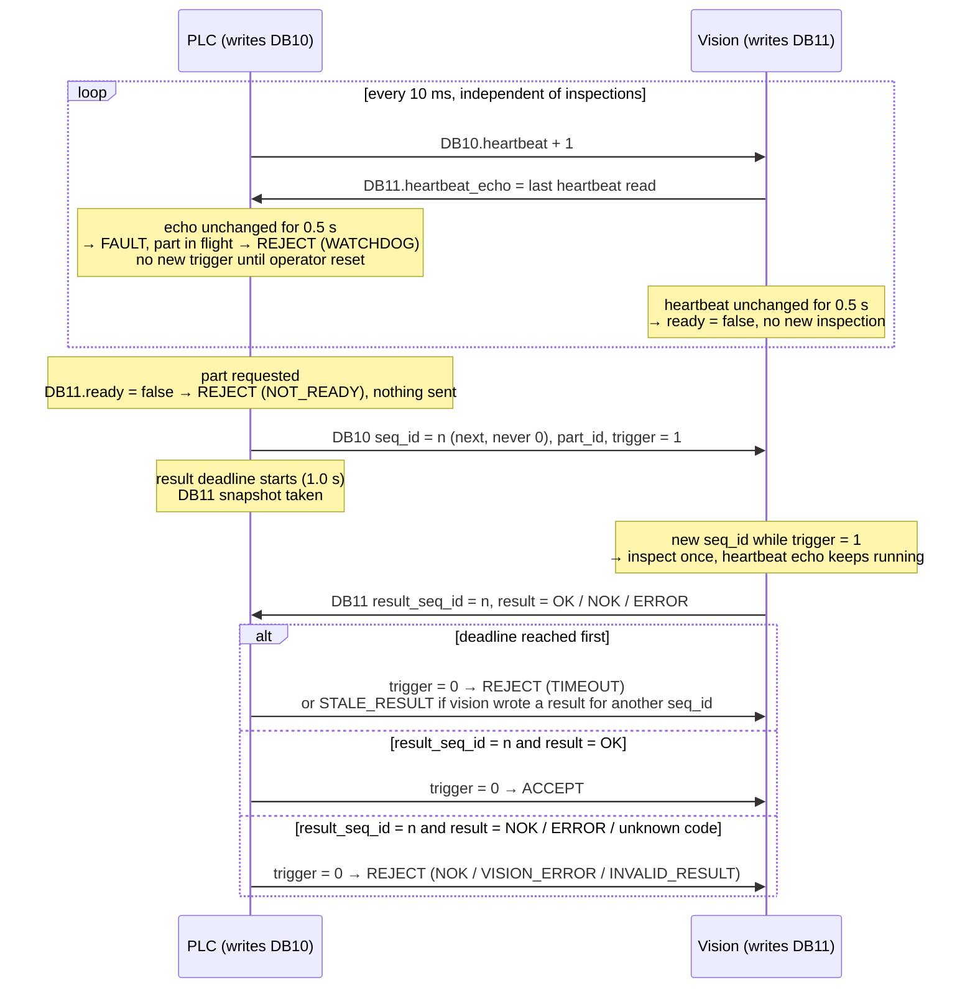

# plc-vision-handshake

[](https://github.com/baig1102/plc-vision-handshake/actions/workflows/ci.yml)

Concept simulation inspired by an inspection cell I commissioned. Contains no employer code.

## The problem

A PLC asks a vision system to inspect a part and reads the answer from a shared
data block, but that block always contains *some* result: maybe the previous
part's, maybe one written after the PLC stopped waiting, maybe one from a vision
process that has since hung. If the PLC acted on such a result, a defective part
could be accepted. So every request carries a sequence ID that the answer must
echo, both sides watch each other's heartbeat, and anything unclear (a late,
stale, missing or unknown result) ends in a reject.

This repo simulates that handshake in Python over the real S7 protocol: a fake
PLC runs a [python-snap7](https://github.com/gijzelaerr/python-snap7) server, and
a vision client talks to it as a snap7 client.

## The handshake

The PLC only writes DB10, and vision only writes DB11. Times are the defaults in
`PlcConfig` and `VisionClient`.



A result with any other `result_seq_id` is never evaluated, so the previous
part's answer still sitting in DB11 can't be accepted for the current part.

## Quick start

Python 3.11 or newer.

```bash
git clone https://github.com/baig1102/plc-vision-handshake.git
```

```bash
cd plc-vision-handshake && pip install -e ".[dev]"
```

```bash
python -m plc_vision_handshake demo --scenario stale
```

`--verbose` also shows every state change. Exit code 0 means the scenario ran to
the end, including when parts were rejected (that is the expected outcome of a
fault scenario); 130 means it was stopped with Ctrl+C.

### Two terminals

The PLC and vision can also run as separate processes, like in a real cell.
Start the PLC first:

```bash
python -m plc_vision_handshake plc
```

It reports a FAULT after 0.5 s because no vision system is connected yet. Then,
in a second terminal:

```bash
python -m plc_vision_handshake vision
```

Back in the first terminal: `r` + Enter resets the FAULT, Enter alone sends the
next part, `q` quits. The vision command takes the fault flags `--slow`,
`--stale-seq`, `--freeze-heartbeat` and `--crash-after N`.

## Scenarios

| Scenario | What happens | Expected verdicts |
|---|---|---|
| `normal` | Vision answers OK | 3 × ACCEPT |
| `nok` | Every second part has a defect | ACCEPT, REJECT NOK, ACCEPT, REJECT NOK |
| `slow` | Vision needs 2.0 s, the result timeout is 1.0 s | REJECT TIMEOUT, no FAULT (the heartbeat keeps running) |
| `stale` | Vision answers with the wrong `seq_id` | REJECT STALE_RESULT |
| `freeze` | Vision hangs during the inspection | REJECT WATCHDOG, then FAULT |
| `restart` | Vision crashes after one part; operator reset; new vision instance | ACCEPT, FAULT, reset, ACCEPT |
| `plc-stop` | The PLC goes to STOP while vision keeps running | ACCEPT; vision drops `ready` |

Real output (times vary slightly from run to run):

```
$ python -m plc_vision_handshake demo --scenario stale
scenario stale: vision answers with the wrong seq_id
  0.000 s  PLC      listening on 127.0.0.1:1102
  0.015 s  VISION   connected, ready                            fault: answers the wrong seq_id
  0.015 s  PART     queued                 seq -   part 1001
  0.031 s  PLC      trigger                seq 1   part 1001
  1.031 s  VERDICT  REJECT  STALE_RESULT   seq 1   part 1001    vision answered a different request
------
1 part: 0 accepted, 1 rejected (STALE_RESULT: 1)
```

```
$ python -m plc_vision_handshake demo --scenario restart
scenario restart: vision crashes and is restarted after a reset
  0.000 s  PLC      listening on 127.0.0.1:1102
  0.016 s  VISION   connected, ready                            fault: crashes after one part
  0.016 s  PART     queued                 seq -   part 1001
  0.032 s  PLC      trigger                seq 1   part 1001
  0.094 s  VERDICT  ACCEPT                 seq 1   part 1001
  0.110 s  VISION   crashed                                     connection dropped, heartbeat echo stops
  0.594 s  PLC      FAULT                                       vision heartbeat stopped - no new triggers until reset
  0.594 s  OPERATOR reset
  0.610 s  PLC      reset                                       FAULT acknowledged
  0.610 s  VISION   connected, ready                            new instance, DB11 overwritten with a clean state
  0.610 s  PART     queued                 seq -   part 1002
  0.625 s  PLC      trigger                seq 2   part 1002
  0.688 s  VERDICT  ACCEPT                 seq 2   part 1002
------
2 parts: 2 accepted, 0 rejected
```

## Design decisions

**Why a sequence ID, and never 0.** DB11 always holds the last answer vision
wrote, so "a result is there" says nothing about which part it belongs to. Every
trigger gets a new `seq_id`, and I only evaluate a result whose `result_seq_id`
matches it. The counter wraps from 65535 to 1 and skips 0: 0 means "no request
yet", which is what an empty DB11 holds, so a real request never uses it (an
empty block is also ignored because its result is NONE; two independent guards).
A reset keeps the counter, so an old answer can never match the next request
either.

**Why a bidirectional watchdog.** A result timeout only tells me that one answer
was late, not whether the other side is still alive. So the PLC requires the
vision's heartbeat echo to keep changing, and vision requires the PLC's
heartbeat to keep changing. If vision dies, the PLC goes to FAULT and rejects
the part in flight; if the PLC stops, vision reports not ready and starts no new
inspection.

**Why fail-to-reject.** A wrongly rejected good part costs a re-inspection; a
wrongly accepted defective part reaches the customer. So every case I can't
prove to be a fresh OK for this exact part ends in a reject: timeout, stale or
unknown result, vision error, not ready, watchdog. Each reject carries its
reason, so the log shows why.

**Why the watchdog is shorter than the result timeout.** Vision freezes a moment
*after* the trigger, so with equal windows the result deadline expires first and
a hung vision is reported as a timeout. With a shorter watchdog (0.5 s against
1.0 s) the reason is correct: WATCHDOG plus FAULT, so the operator knows the
vision system needs attention, not just one part. I found this when an
integration test with equal windows failed intermittently.

**Why pure logic and an injected clock.** The state machine (`plc_logic.py`) and
the vision side's logic have no sockets, threads or sleeps: one call per cycle,
inputs in, outputs out, and time comes from a clock that is passed in. That lets
the tests step time exactly (0.25 s steps) and hit boundaries like "still
waiting at 0.75 s, rejected at exactly 1.0 s" without flaky sleeps. The snap7
server, client and threads are thin wrappers around that logic.

**Why `ready` is never trusted without the heartbeat.** DB11 keeps its last
content when vision dies, including `ready = true`. So `ready` only decides
whether a trigger may be sent; whether vision is alive is decided by the
heartbeat echo, which the PLC checks first in every cycle, before it looks at a
result. A dead vision that still shows `ready` is caught within one watchdog
window, and the part in flight is rejected.

## What the tests cover

67 tests, all running in CI on Python 3.11 and 3.12:

- **Protocol (15):** encode/decode round trips, hand-written byte layouts that pin
  offsets and big-endian order, range and size checks.
- **PLC state machine (23):** every transition on a fake clock. Sequence
  matching, stale and leftover results, timeout boundary, watchdog priority over
  a result in the same cycle, reset keeps `seq_id`, every verdict reported as an
  event.
- **Vision logic (6):** each `seq_id` answered once, heartbeat echo during
  inspection, vision-side watchdog, fault flags.
- **Over a real snap7 connection (6):** normal parts accepted, plus one test per
  fault: slow vision → TIMEOUT, wrong seq → STALE_RESULT, frozen heartbeat →
  WATCHDOG and FAULT, vision restart → reset → accepted without reusing the old
  result, halted PLC → vision drops `ready`.
- **Event log (4):** line format, reasons in plain words, summary.
- **CLI (12):** the output of every demo scenario, Ctrl+C (exit 130, no
  traceback, threads stopped; the real-signal test runs on Linux only), flag
  parsing, usage errors.
- **Package (1):** import smoke test.

The important guards were also mutation-checked: each one was broken on purpose
to confirm that a test fails.

```bash
pytest
```

`pytest -m "not integration"` skips the tests that open a real TCP connection.

## Limitations

- **A simulation, not PLC code.** The PLC logic is Python, not TIA Portal
  (SCL/LAD) code for an S7 CPU, and it runs on a PC: cycle times are not
  deterministic like a real PLC scan.
- **No safety system.** Rejecting a part is quality logic. Nothing here is a
  safety function (no emergency stop, no guarding, no SIL or PL rating); in a
  real cell that is a separate, certified system.
- **snap7 instead of a real CPU.** The fake PLC is a python-snap7 server. A real
  S7-1200/1500 needs PUT/GET access enabled and non-optimized data blocks for
  absolute addressing, which is not configured or tested here.
- **One machine, localhost only.** Both sides talk over 127.0.0.1; network
  latency, cable faults and multiple vision systems are out of scope.

## Status

| # | Milestone | Status |
|---|---|---|
| 1 | Project skeleton, CI | ✅ done |
| 2 | `protocol.py`: DB10/DB11 byte layout and codec | ✅ done |
| 3 | `plc_logic.py`: PLC state machine with injected clock | ✅ done |
| 4 | `fake_plc.py` + `vision_client.py` over snap7, first integration test | ✅ done |
| 5 | Fault injection and failure scenarios | ✅ done |
| 6 | CLI demo with event log | ✅ done |
| 7 | Final README, `v0.1.0` | ✅ done |

## License

[MIT](LICENSE)

Built with Claude Code; design and review by me.
