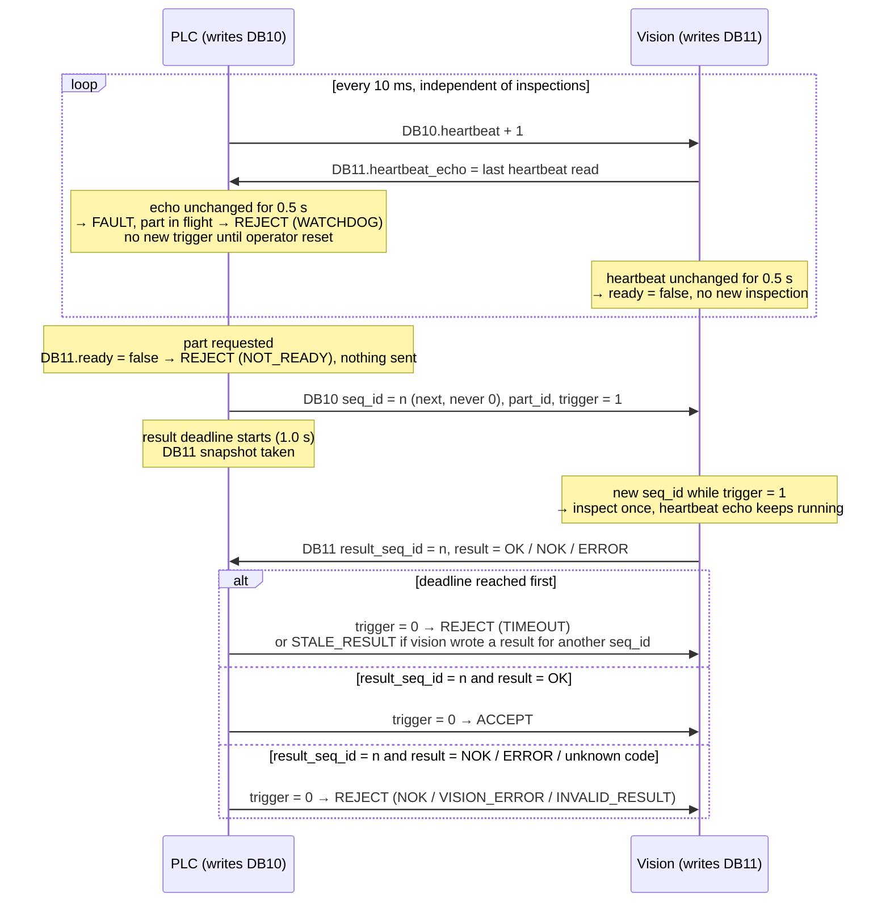

# plc-vision-handshake

[](https://github.com/baig1102/plc-vision-handshake/actions/workflows/ci.yml)

Concept simulation inspired by an inspection cell I commissioned. Contains no employer code.

> **Interim README.** Milestones 1–6 are done.
> The final README (scenarios table, design decisions, demo) comes with v0.1.0.

## The problem

A PLC asks a vision system to inspect a part and reads the answer from a shared
data block, but that block always contains *some* result: maybe the previous
part's, maybe one written after the PLC stopped waiting, maybe one from a vision
process that has since hung. If the PLC acted on such a result, a defective part
could be accepted. So every request carries a sequence ID that the answer must
echo, both sides watch each other's heartbeat, and anything unclear (a late,
stale, missing or unknown result) ends in a reject.

This repo simulates that handshake in Python over the real S7 protocol: a fake
PLC runs a [python-snap7](https://github.com/gijzelaerr/python-snap7) server, and
a vision client talks to it as a snap7 client.

## The handshake

The PLC only writes DB10, and vision only writes DB11. Times are the defaults in
`PlcConfig` and `VisionClient`.



A result with any other `result_seq_id` is never evaluated, so the previous
part's answer still sitting in DB11 can't be accepted for the current part.

## Status

| # | Milestone | Status |
|---|---|---|
| 1 | Project skeleton, CI | ✅ done |
| 2 | `protocol.py`: DB10/DB11 byte layout and codec | ✅ done |
| 3 | `plc_logic.py`: PLC state machine with injected clock | ✅ done |
| 4 | `fake_plc.py` + `vision_client.py` over snap7, first integration test | ✅ done |
| 5 | Fault injection and failure scenarios | ✅ done |
| 6 | CLI demo with event log | ✅ done |
| 7 | Final README, `v0.1.0` | ⏳ planned |

## Install and test

Python 3.11 or newer.

```bash
pip install -e ".[dev]"
```

```bash
pytest
```

`pytest -m "not integration"` skips the tests that open a real TCP connection.

## Run the demo

```bash
python -m plc_vision_handshake demo --scenario stale
```

Scenarios: `normal`, `nok`, `slow`, `stale`, `freeze`, `restart`, `plc-stop`.
`--verbose` also shows every state change. Exit code 0 means the scenario ran to
the end, including when parts were rejected; 130 means it was stopped with Ctrl+C.

Or in two terminals: `python -m plc_vision_handshake plc` (Enter = next part,
r = reset, q = quit), then `python -m plc_vision_handshake vision`, optionally
with `--slow`, `--stale-seq`, `--freeze-heartbeat` or `--crash-after N`.

## What the tests cover

67 tests, all running in CI on Python 3.11 and 3.12:

- **Protocol (15):** encode/decode round trips, hand-written byte layouts that pin
  offsets and big-endian order, range and size checks.
- **PLC state machine (23):** every transition on a fake clock. Sequence
  matching, stale and leftover results, timeout boundary, watchdog priority over
  a result in the same cycle, reset keeps `seq_id`, every verdict reported as an
  event.
- **Vision logic (6):** each `seq_id` answered once, heartbeat echo during
  inspection, vision-side watchdog, fault flags.
- **Over a real snap7 connection (6):** normal parts accepted, plus one test per
  fault: slow vision → TIMEOUT, wrong seq → STALE_RESULT, frozen heartbeat →
  WATCHDOG and FAULT, vision restart → reset → accepted without reusing the old
  result, halted PLC → vision drops `ready`.
- **Event log (4):** line format, reasons in plain words, summary.
- **CLI (12):** the output of every demo scenario, Ctrl+C (exit 130, no
  traceback, threads stopped; the real-signal test runs on Linux only), flag
  parsing, usage errors.
- **Package (1):** import smoke test.

The important guards were also mutation-checked: each one was broken on purpose
to confirm that a test fails.

## License

[MIT](LICENSE)

Built with Claude Code; design and review by me.
